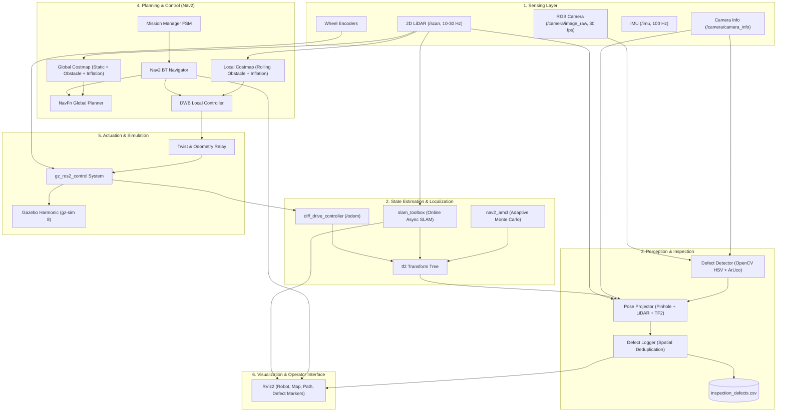

# System Architecture Specification

> **Project:** ASCEND-GROUND (Autonomous Inspection Rover)  
> **Course:** Robotics and Intelligent Autonomous Systems (IIIT Dharwad)  
> **Lead:** Raskin Verma

---

## 1. System Overview

The ASCEND-GROUND system is an autonomous ground robot architecture designed for repetitive visual inspection of industrial infrastructure. The robot traverses indoor environments, builds a consistent 2D metric map via graph-based LiDAR SLAM, navigates autonomously between predefined and discovered inspection waypoints using Nav2, detects physical defects (corrosion/rust, fluid leaks, and ArUco asset tags) via OpenCV, and tags anomalies with global map coordinates.

---

## 2. Architectural Block Diagram



---

## 3. Coordinate Frames & TF Tree Contract

The transform tree complies strictly with **REP-105** (Coordinate Frames for Mobile Platforms) and **REP-103** (Standard Units of Measure & Coordinate Conventions).

```
map
 └── odom                   (published by slam_toolbox during mapping, AMCL during localization)
      └── base_footprint    (published by diff_drive_controller odometry)
           └── base_link    (robot structural origin at wheel axle height)
                ├── lidar_link                (LiDAR sensor origin at z = +0.14 m)
                ├── camera_link               (Camera physical housing, z = +0.18 m, pitch = -10°)
                │    └── camera_optical_frame (REP-103 optical convention: z forward, x right, y down)
                ├── imu_link                  (IMU sensor origin at z = +0.08 m)
                ├── left_wheel_link           (Left drive wheel origin at y = +0.135 m)
                ├── right_wheel_link          (Right drive wheel origin at y = -0.135 m)
                └── caster_link               (Passive support caster at x = +0.12 m)
```

---

## 4. Topic Contract

| Topic | Message Type | Publisher | Subscriber(s) | Description |
|---|---|---|---|---|
| `/scan` | `sensor_msgs/LaserScan` | Gazebo (`ros_gz_bridge`) | `slam_toolbox`, `nav2_costmap`, `pose_projector` | 360° planar laser scan (12 m range, 1° res) |
| `/camera/image_raw` | `sensor_msgs/Image` | Gazebo (`ros_gz_bridge`) | `defect_detector` | 640×480 RGB camera stream at 30 fps |
| `/camera/camera_info` | `sensor_msgs/CameraInfo` | Gazebo (`ros_gz_bridge`) | `defect_detector`, `pose_projector` | Camera intrinsic calibration matrix $K$ |
| `/imu` | `sensor_msgs/Imu` | Gazebo (`ros_gz_bridge`) | `robot_localization` (optional) | 100 Hz linear acceleration and angular velocity |
| `/cmd_vel` | `geometry_msgs/Twist` | `nav2`, `teleop`, `mission_manager` | `twist_relay` | Commanded body velocity ($v_x, \omega_z$) |
| `/diff_drive_controller/cmd_vel` | `geometry_msgs/TwistStamped` | `twist_relay` | `diff_drive_controller` | Time-stamped command for controller manager |
| `/diff_drive_controller/odom` | `nav_msgs/Odometry` | `diff_drive_controller` | `twist_relay` | Raw wheel odometry integration |
| `/odom` | `nav_msgs/Odometry` | `twist_relay` | `nav2`, `slam_toolbox` | Standard odometry topic |
| `/tf`, `/tf_static` | `tf2_msgs/TFMessage` | `robot_state_publisher`, `diff_drive_controller`, SLAM | Entire stack | Dynamic and static coordinate transformations |
| `/map` | `nav_msgs/OccupancyGrid` | `slam_toolbox` / `map_server` | `nav2`, RViz2 | 2D occupancy grid map ($0.05\,\text{m}$ resolution) |
| `/defect_detections` | `rover_interfaces/Defect` | `defect_detector` | `pose_projector` | 2D pixel-space detections with confidence |
| `/defect_events` | `rover_interfaces/Defect` | `pose_projector` | `defect_logger` | 3D map-referenced defect positions |
| `/defects` | `visualization_msgs/MarkerArray` | `defect_logger` | RViz2 | Persistent 3D spheres & labels in RViz |

---

## 5. Node Inventory

| Node Name | Package | Executable Type | Role |
|---|---|---|---|
| `robot_state_publisher` | `robot_state_publisher` | C++ | Broadcasts static URDF transforms to `/tf_static` |
| `parameter_bridge` | `ros_gz_bridge` | C++ | Bridges sensor topics between Gazebo Harmonic and ROS 2 |
| `twist_relay` | `rover_gazebo` | Python | Bridges `/cmd_vel` and `/odom` to `diff_drive_controller` |
| `defect_detector` | `rover_perception` | Python | Dual-band HSV color thresholding + ArUco marker detection |
| `pose_projector` | `rover_perception` | Python | Pinhole back-projection + TF2 spatial transformation |
| `defect_logger` | `rover_perception` | Python | Spatial deduplication ($<0.35\,\text{m}$), CSV logging, RViz markers |
| `mission_manager` | `rover_mission` | Python | FSM navigating waypoints, executing scanning rotations |
| `async_slam_toolbox_node` | `slam_toolbox` | C++ | 2D graph SLAM and loop closure |
| Nav2 Stack Servers | `nav2_*` | C++ | Global planner, DWB local controller, costmaps, BT navigator |
