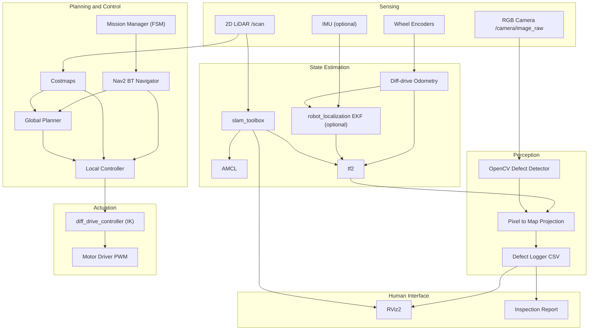

# PROJECT ASCEND-GROUND: Autonomous Inspection Rover
### Robotics and Intelligent Autonomous Systems: Course Project
**Faculty:** Dr. Sunil C K | **Institute:** IIIT Dharwad
**Team Lead / Foundation Owner:** Raskin Verma
**Repo:** `inspection_rover`
**Started:** 2026-10-06 | **Deadline:** 2026-10-20 (14 days)

> **This plan is built for 14 days, not 8 weeks.** Every item is either MUST (needed for a passing, demonstrable project), SHOULD (do if on schedule at the checkpoint), or CUT (written down so nobody starts it). Anything marked CUT is deferred, not forgotten: it goes in the viva answer to "what would you do with more time?"

---

## 1. PROJECT DEFINITION

### 1.1 One-line statement
A differential-drive autonomous ground rover that explores an unknown indoor environment, builds a 2D occupancy map via LiDAR SLAM, navigates to inspection waypoints with Nav2, detects visual defects (coloured and ArUco markers) with an onboard camera, and logs each detection with global map coordinates.

### 1.2 Problem being solved
Industrial facilities (substations, warehouses, pipelines, server rooms) need repetitive visual inspection. Manual inspection is slow, inconsistent, and sometimes unsafe. An autonomous rover performs repeatable sweeps, flags anomalies, and produces a geo-tagged defect report. Real-world analogues: ABB/Siemens substation inspection robots, Boston Dynamics Spot inspection missions, ANYbotics ANYmal.

### 1.3 Scope (14-day edition)

| MUST (in scope) | SHOULD (if on schedule) | CUT (explicitly out) |
|---|---|---|
| Gazebo sim of rover, teleop, correct `/odom` `/tf` `/scan` camera | EKF with IMU (`robot_localization`) | Frontier exploration |
| 2D LiDAR SLAM (`slam_toolbox`), saved map | Planner comparison table (NavFn vs Smac) | CNN / ONNX classifier |
| AMCL localization on saved map | Auto-generated markdown inspection report | Physical pan-tilt mast (DH derived on paper only) |
| Nav2 goal + multi-waypoint navigation | Hardware: teleop + live camera detection | Controller comparison (DWB/MPPI/RPP) |
| OpenCV HSV + ArUco detection | Dynamic obstacle replanning demo | 3D SLAM, outdoor GPS, crowd prediction |
| Pixel → map projection via tf2 | 10-run mission success statistics | Torque-sizing beyond a one-page calculation |
| Defect log (CSV) + RViz markers | | Phase 9 arm (stays a viva talking point) |
| Mission FSM visiting waypoints | | CI pipeline, PDF reports, web dashboard |
| Hand-derived kinematics + DH + docs | | Custom firmware beyond what hardware needs |

### 1.4 Success criteria

**Pass (must be true by Oct 17 evening, feature freeze):**
- Rover spawns in Gazebo, drivable via teleop, `/odom` and `/tf` correct
- SLAM produces a usable map of the custom world, map saved
- Nav2 reaches a goal set in RViz without collision
- Camera detects a coloured/ArUco marker and publishes its map pose

**Target (strong grade):**
- Pass items plus: unattended multi-waypoint mission via one command
- Defects logged to CSV with `(x, y)` map coords, timestamp, image crop
- Persistent defect markers in RViz
- Docs 02 (kinematics), 04 (SLAM/Nav) and 07 (metrics) complete with real numbers
- Hardware: real rover teleop + live detection **or** a documented fallback (see §7)

**Stretch (only if everything above is done):**
- IMU + EKF, planner comparison, dynamic-obstacle replanning, auto-report

---

---

## 3. SYSTEM ARCHITECTURE

### 3.1 Block diagram



### 3.2 TF tree (must be exactly this)

```
map
 └── odom                   (published by slam_toolbox in mapping, amcl in localization)
      └── base_footprint    (published by diff-drive odometry)
           └── base_link
                ├── lidar_link
                ├── camera_link
                │    └── camera_optical_frame   (REP-103 optical convention)
                ├── imu_link
                ├── left_wheel_link
                ├── right_wheel_link
                └── caster_link
```

### 3.3 Topic contract

| Topic | Type | Publisher | Subscriber |
|---|---|---|---|
| `/scan` | `sensor_msgs/LaserScan` | Gazebo lidar via `ros_gz_bridge` | slam_toolbox, Nav2 costmaps |
| `/camera/image_raw` | `sensor_msgs/Image` | Gazebo camera | perception node |
| `/camera/camera_info` | `sensor_msgs/CameraInfo` | Gazebo camera | perception node |
| `/odom` | `nav_msgs/Odometry` | diff_drive_controller | Nav2, EKF |
| `/cmd_vel` | `geometry_msgs/Twist` | Nav2 / teleop | diff_drive_controller |
| `/tf`, `/tf_static` | `tf2_msgs/TFMessage` | robot_state_publisher, SLAM | everything |
| `/map` | `nav_msgs/OccupancyGrid` | slam_toolbox / map_server | Nav2, RViz |
| `/defects` | `visualization_msgs/MarkerArray` | perception node | RViz |
| `/defect_events` | `rover_interfaces/Defect` | perception node | defect_logger |
| `/joint_states` | `sensor_msgs/JointState` | gz_ros2_control | robot_state_publisher |

---

## 4. TECH STACK (locked, do not debate)

| Layer | Choice | Why |
|---|---|---|
| OS | Ubuntu 24.04 LTS | Native target for ROS 2 Jazzy |
| Shell | zsh | Source `setup.zsh`, not `setup.bash` |
| ROS | ROS 2 Jazzy Jalisco | LTS matched to 24.04 |
| Simulator | Gazebo Harmonic (gz-sim 8) via `ros_gz` | Jazzy's default pairing |
| Build | colcon, `ament_cmake` (resources) and `ament_python` (nodes) | Standard |
| Robot description | XACRO → URDF | Parametric, reusable |
| HW interface | `gz_ros2_control` + `diff_drive_controller` | Same controller config works on real HW |
| SLAM | `slam_toolbox` (async) | Graph SLAM with loop closure |
| Localization | `nav2_amcl` | Particle filter on saved map |
| Navigation | Nav2 (NavFn planner, DWB controller by default) | Full stack, defaults work |
| Perception | OpenCV 4 + `cv_bridge`, ArUco | Existing OpenCV strength |
| Visualisation | RViz2 | Required for demo |
| Mission | Python FSM + `nav_through_poses` / `NavigateToPose` action client | Simple, explainable in viva |
| VCS | Git + GitHub | Team sync |

### 4.1 Packages to install

```bash
sudo apt update && sudo apt install -y \
  ros-jazzy-ros-gz \
  ros-jazzy-gz-ros2-control \
  ros-jazzy-ros2-control ros-jazzy-ros2-controllers \
  ros-jazzy-navigation2 ros-jazzy-nav2-bringup \
  ros-jazzy-slam-toolbox \
  ros-jazzy-robot-state-publisher ros-jazzy-joint-state-publisher-gui \
  ros-jazzy-xacro \
  ros-jazzy-teleop-twist-keyboard \
  ros-jazzy-rviz2 \
  ros-jazzy-tf2-tools ros-jazzy-tf-transformations \
  ros-jazzy-cv-bridge ros-jazzy-image-transport ros-jazzy-vision-msgs \
  ros-jazzy-robot-localization \
  python3-colcon-common-extensions python3-rosdep python3-opencv
```

---

## 5. REPOSITORY STRUCTURE

The GitHub repo is the whole workspace so teammates clone once and build.

```
inspection_rover/                  <-- repo root == ros2_ws
├── README.md                      quickstart, demo GIF, team, results
├── PLAN.md                        this file
├── .gitignore
├── docs/
│   ├── 01_architecture.md
│   ├── 02_kinematics_derivation.md    diff-drive FK/IK + mast DH table
│   ├── 03_dynamics_and_control.md     inertia, torque budget, PID
│   ├── 04_slam_and_navigation.md      theory, params, results
│   ├── 05_perception.md               pipeline, calibration, results
│   ├── 06_hardware.md                 BOM, wiring, power budget
│   ├── 07_results_and_benchmarks.md   metric tables
│   ├── 08_viva_qna.md                 Q&A bank (§9)
│   └── media/
└── src/
    ├── rover_description/   [ament_cmake]  urdf/ (rover, base, sensors, inertial_macros, gazebo_plugins, materials), rviz/, launch/rsp.launch.py
    ├── rover_gazebo/        [ament_cmake]  worlds/ (inspection_facility.sdf, empty_test.sdf), models/, config/ (diff_drive_controller.yaml, gz_bridge.yaml), launch/sim.launch.py
    ├── rover_navigation/    [ament_cmake]  config/ (slam_toolbox, nav2_params, amcl), maps/, launch/ (slam, localization, navigation)
    ├── rover_perception/    [ament_python] defect_detector.py, pose_projector.py, defect_logger.py, config/detector_params.yaml, test/
    ├── rover_mission/       [ament_python] mission_manager.py, waypoint_loader.py, config/inspection_waypoints.yaml
    ├── rover_interfaces/    [ament_cmake]  msg/Defect.msg
    └── rover_bringup/       [ament_cmake]  launch/full_sim.launch.py
```

Merged from the 8-week plan: `rover_firmware` is created **only** if hardware parts arrive (§7). `mast.xacro`, `cnn_classifier.py`, `frontier_explorer.py`, `report_generator.py` are deferred.

### 5.1 `.gitignore` (create first)

```gitignore
build/
install/
log/
__pycache__/
*.pyc
*.pyo
.vscode/
.idea/
*.swp
*.bag
*.db3
*.mcap
.DS_Store
```

---

## 6. 14-DAY EXECUTION SCHEDULE

Day 1 is **Tue Oct 6**. Oct 20 is submission day and is treated as **buffer only**, not working time. **Feature freeze: Sat Oct 17 night.** After that: docs, bugs, rehearsal.

**Rule that protects the schedule:** integrate continuously. `full_sim.launch.py` exists from Day 4 and grows every day. Nobody saves "integration" for the end.

### Days 1-2 (Oct 6-7): Foundation
| # | Task | Done when | Owner |
|---|---|---|---|
| 1.1 | Create repo, push README + `.gitignore` + PLAN.md, add teammates | Repo live | R |
| 1.2 | Install apt block, verify `gz sim --versions` = 8.x, `ros2 doctor` clean | No errors | R |
| 1.3 | Create 7 skeleton packages | `colcon build` finishes 7 packages | R |
| 1.4 | `inertial_macros.xacro`, `base.xacro`, `sensors.xacro` | TF tree correct in `view_frames` | R |
| 1.5 | `rsp.launch.py` + RViz config | Rover visible, joints movable | R |
| 1.6 | **Order hardware today** (§7) | Order placed or fallback chosen | M3 |

**Gate 1:** rover in RViz with valid TF tree. Tag `v0.1-description`.

### Days 3-4 (Oct 8-9): Simulation and teleop
| # | Task | Done when | Owner |
|---|---|---|---|
| 2.1 | `gazebo_plugins.xacro`: gz lidar, camera, IMU, ros2_control tags | Topics in `gz topic -l` | R |
| 2.2 | `diff_drive_controller.yaml`, `gz_bridge.yaml` | Controllers active | M2 |
| 2.3 | `inspection_facility.sdf` (closed loop, 2 rooms, corridor, doorway, pipes, 6 markers) | World loads | M3 |
| 2.4 | `sim.launch.py` | Rover spawns, no errors | R |
| 2.5 | Teleop test, verify `/odom` over 1 m drive reads about 1.0 m | Pass | M2 |
| 2.6 | `/scan` and `/camera/image_raw` visible in RViz | Aligned with world | R |

**Gate 2:** teleop around the facility with all sensors sane. Tag `v0.2-sim-teleop`. Record 30 s GIF.

### Days 5-6 (Oct 10-11): SLAM and perception start (parallel)
| # | Task | Done when | Owner |
|---|---|---|---|
| 3.1 | `slam_toolbox_online_async.yaml`, `slam.launch.py` | SLAM runs with sim | M2 |
| 3.2 | Teleop-map the facility, trigger loop closure, save map via `map_saver_cli` | `facility.pgm/.yaml` committed, no double walls | M2 + M3 |
| 3.3 | `localization.launch.py` with AMCL | Particle cloud converges | M2 |
| 3.4 | `defect_detector.py`: HSV + morphology + contours, ArUco | Bbox + centroid published on live sim camera | R |
| 3.5 | `Defect.msg` in `rover_interfaces` | Builds | R |

**Gate 3:** saved map + AMCL localizing; detector sees markers. Tag `v0.4-slam`.

### Days 7-8 (Oct 12-13): Navigation
| # | Task | Done when | Owner |
|---|---|---|---|
| 4.1 | `nav2_params.yaml` from `nav2_bringup` defaults, set footprint, velocity limits | Nodes all active | M3 |
| 4.2 | `navigation.launch.py` | Bringup stable | M3 |
| 4.3 | Single goal via RViz | Reaches goal, no collision | M3 |
| 4.4 | Costmap tuning (inflation, doorway) | No corner clipping or doorway freeze | M3 |
| 4.5 | Multi-waypoint test (`nav_through_poses`) | 4-waypoint loop completes | M3 |
| 4.6 | `pose_projector.py` | Defect map coords within ±15 cm of ground truth | R |

**Gate 4:** reliable autonomous point-to-point nav. Tag `v0.5-navigation`.
*Change one Nav2 param at a time and log every change in `docs/04`.*

### Days 9-10 (Oct 14-15): Perception integration
| # | Task | Done when | Owner |
|---|---|---|---|
| 5.1 | `defect_logger.py`: dedupe by proximity, CSV + image crop | No duplicate entries | R |
| 5.2 | `/defects` MarkerArray persistent in RViz | Coloured spheres pinned on map | R |
| 5.3 | Drive-by test: pass a defect, see it in RViz and CSV | Pass | R |
| 5.4 | Begin hardware bring-up if parts arrived (§7) | Teleop works | M2/M3 |
| 5.5 | Start `docs/02` and `docs/03` (hand derivations) | Drafts in repo | R |

**Gate 5:** defect appears at the right place and is logged. Tag `v0.6-perception`.

### Days 11-12 (Oct 16-17): Mission integration, then FREEZE
| # | Task | Done when | Owner |
|---|---|---|---|
| 6.1 | `inspection_waypoints.yaml` | Loaded by mission node | M3 |
| 6.2 | `mission_manager.py` FSM: IDLE → NAV_TO_WP → SCAN → LOG → NEXT_WP → RETURN_HOME | Transitions logged in terminal | R |
| 6.3 | Action client with timeout + retry | Recovers from one failed goal | R |
| 6.4 | At each waypoint: pause, rotate in place, capture | Visible in demo | R |
| 6.5 | `full_sim.launch.py` | One command launches everything | R |
| 6.6 | Run mission 10×, log successes/failures | ≥ 7/10 (target 8/10) | All |
| 6.7 | **Feature freeze Sat Oct 17 night** | Tag `v1.0-sim-complete` | All |

**Gate 6:** one-command autonomous mission end to end. Record full uncut video as soon as it works, even if imperfect, as demo-day insurance.

### Day 13 (Oct 18): Docs and metrics
- Finish `docs/01`-`docs/08`. Fill `docs/07` with real numbers (§9.3).
- Generate `view_frames` PDF and `rqt_graph` export.
- Clean-clone test on another machine: clone, build, run, zero manual fixes.
- Record `ros2 bag` of a full mission (replay fallback).

### Day 14 (Oct 19): Rehearsal
- Dry-run the full demo 3× (§9.2). Cross-teach so every member can explain every part.
- Final README with GIF, architecture, quickstart. Tag `v2.0-final`.
- Charge, pack, and test hardware if used.

### Oct 20: Submission / buffer. Do not plan new work here.

### Checkpoint rules (be ruthless)
- **End of Oct 11:** if SLAM map is not saved, drop SHOULD items and the hardware LiDAR idea permanently.
- **End of Oct 13:** if Nav2 doesn't reach a single goal, mission FSM moves to simple "drive waypoint list with `NavigateToPose`", and nothing else is added.
- **Oct 17 night:** freeze. Only bug fixes and docs after this.

---

## 7. HARDWARE (parallel track, never blocks simulation)

Hardware is part of the 60% marks, but **parts ordered Oct 6 may not arrive and be debugged before Oct 20**. Treat it as best effort with a pre-agreed fallback.

**Decision on Day 2:** can you get parts in hand by Oct 11 (reuse existing items, borrow from lab/seniors, or local-store pickup)?

| Path | Condition | What you demo physically |
|---|---|---|
| **A: Minimal rover** | Chassis + motors + driver + Arduino + webcam available by Oct 11 | Teleop-driven real rover + live defect detection from its camera |
| **B: Perception-on-hardware** | No chassis in time, but you have a webcam and a laptop/RPi | Real webcam running the same perception node on a printed ArUco/coloured marker, shown live next to the sim |
| **C: Lidar upgrade** | Only if Gate 3 passed early **and** RPLiDAR is already in hand | Real corridor SLAM. Treat as a bonus, never plan for it |

**Do not** attempt autonomous Nav2 on real hardware or the pan-tilt mast physically in this timeline.

### 7.1 Hardware tasks (Path A)
| # | Task | Done when | Owner |
|---|---|---|---|
| H1 | Assemble chassis, motors, caster | Mechanically sound | M3 |
| H2 | Wire driver, encoders, buck converter, battery | Powers up, no brownout | M3 |
| H3 | Arduino firmware: encoder counts + per-wheel PID + serial | RPM tracked within 5% | M2 |
| H4 | Bridge node → `/cmd_vel` + `/odom` (serial) | Teleop drives real robot | M2 |
| H5 | Odometry calibration (2 m drive, adjust radius/track) | Error < 5% | M3 |
| H6 | Camera streaming, checkerboard calibration | Reprojection < 0.5 px | R |
| H7 | Perception node on real camera | Detects printed marker live | R |

### 7.2 BOM (reference prices)

| # | Item | Spec | Est. ₹ |
|---|---|---|---|
| 1 | Chassis + 2 geared DC motors + wheels | 12 V, ~200 RPM, encoders | 2,200 |
| 2 | Caster wheel | | 100 |
| 3 | Raspberry Pi 4 (4 GB) | skip if reusing | 5,500 |
| 4 | microSD 32 GB class-10 | | 500 |
| 5 | Arduino Nano / Uno | motor PID + encoders | 500 |
| 6 | TB6612FNG or L298N driver | | 250 |
| 7 | USB webcam | 720p UVC | 800 |
| 8 | Li-ion 3S pack / 12 V power bank | ≥ 2200 mAh | 1,200 |
| 9 | Buck converter 12 V → 5 V 3 A | for Pi | 200 |
| 10 | Wires, connectors, switch, fuse, standoffs | | 400 |
| | **Subtotal** | | **~₹11,650** (~₹6,150 if Pi reused) |
| opt | RPLiDAR A1M8 | 360°, 12 m | 6,000 |
| opt | IMU MPU6050 / BNO055 | | 300-1,200 |

**Power budget:** Pi 4 ≈ 7 W load, LiDAR ≈ 2.5 W, motors ≈ 12 W peak, camera ≈ 1 W → size for ~20-28 W peak. A 2200 mAh 3S pack (~24 Wh) gives roughly 45-50 min. Document in `docs/06`.

---

## 8. TECHNICAL SPECIFICATIONS

### 8.1 Rover parameters (locked, used everywhere)

| Parameter | Value |
|---|---|
| Chassis L × W × H | 0.35 × 0.25 × 0.08 m |
| Chassis mass | 2.5 kg |
| Wheel radius r | 0.0425 m |
| Wheel width | 0.030 m |
| Wheel separation L | 0.27 m (centre-to-centre) |
| Caster | sphere, r = 0.020 m |
| Max linear velocity | 0.5 m/s |
| Max angular velocity | 1.5 rad/s |
| Max linear accel | 1.0 m/s² |
| LiDAR mount | 0.14 m above `base_link` |
| Camera mount | 0.18 m, pitched −10° |
| LiDAR | 0.12-12.0 m, 360°, 1° res, 10 Hz |
| Camera | 640×480, 30 fps, 60° HFOV |

### 8.2 Differential-drive kinematics (derive by hand in `docs/02`)

**Forward kinematics** (wheel speeds → body twist):

$$v = \frac{r(\omega_R + \omega_L)}{2}, \qquad \omega = \frac{r(\omega_R - \omega_L)}{L}$$

**Inverse kinematics** (body twist → wheel speeds):

$$\omega_R = \frac{v + \omega L/2}{r}, \qquad \omega_L = \frac{v - \omega L/2}{r}$$

**Odometry integration** (midpoint, timestep $\Delta t$):

$$\theta_{k+1} = \theta_k + \omega\,\Delta t$$
$$x_{k+1} = x_k + v\cos\!\left(\theta_k + \tfrac{\omega \Delta t}{2}\right)\Delta t$$
$$y_{k+1} = y_k + v\sin\!\left(\theta_k + \tfrac{\omega \Delta t}{2}\right)\Delta t$$

**Non-holonomic constraint** (no lateral slip):

$$\dot{x}\sin\theta - \dot{y}\cos\theta = 0$$

**Homogeneous transform chain** (pixel to map):

$$p^{\text{map}} = T^{\text{map}}_{\text{base}}\; T^{\text{base}}_{\text{cam}}\; p^{\text{cam}}$$

**Pinhole back-projection** (used in `pose_projector.py`):

$$\begin{bmatrix} u \\ v \\ 1 \end{bmatrix} = \frac{1}{Z}\begin{bmatrix} f_x & 0 & c_x \\ 0 & f_y & c_y \\ 0 & 0 & 1 \end{bmatrix}\begin{bmatrix} X \\ Y \\ Z \end{bmatrix}$$

Depth $Z$ comes from the ArUco marker's known size, or from the LiDAR range at the matching bearing for coloured markers.

### 8.3 Pan-tilt mast DH table (paper derivation, closes Unit II)

| i | $a_{i-1}$ | $\alpha_{i-1}$ | $d_i$ | $\theta_i$ |
|---|---|---|---|---|
| 1 (pan) | 0 | 0 | $d_1$ | $\theta_1$ |
| 2 (tilt) | 0 | $+90°$ | 0 | $\theta_2$ |
| cam (fixed) | $a_2$ | 0 | 0 | 0 |

Derive $T^0_{\text{cam}} = T^0_1\,T^1_2\,T^2_{\text{cam}}$. For a target $(x_t, y_t, z_t)$ in the mast base frame:

$$\theta_1 = \operatorname{atan2}(y_t, x_t), \qquad \theta_2 = \operatorname{atan2}\!\left(z_t - d_1,\ \sqrt{x_t^2 + y_t^2}\right)$$

State the simplifying assumption (camera offset $a_2$ ignored in the IK) explicitly in `docs/02`; a viva examiner will ask.

### 8.4 Dynamics and control (one page in `docs/03`)
- Inertia of box: $I_{xx} = \tfrac{m}{12}(w^2+h^2)$ etc.; cylinder for wheels. Put these in `inertial_macros.xacro`.
- Torque budget: required wheel torque $\tau = \frac{r}{2}\,(m a + \mu m g)$ per wheel for the worst case (0.5 m/s in 0.5 s, μ ≈ 0.05-0.1). Show the number and justify the motor.
- PID: record one step-response plot per wheel. Targets: settling < 0.5 s, overshoot < 10%.

### 8.5 Gazebo inspection facility
- Outer walls forming a **closed loop** (mandatory for loop closure)
- 2 rooms, 1 corridor, 1 narrow doorway
- Vertical pipes and a shelf rack (costmap test)
- **6 defect markers:** 2× red (rust), 2× yellow (leak), 2× ArUco (asset tags)
- 1 movable box (dynamic-obstacle test, SHOULD)
- Ground-truth coordinates written down for every marker (needed for error metrics)

---

### 9.2 Demo script (rehearse exactly)
1. **(30 s)** Problem + architecture slide.
2. **(1 min)** RViz: live TF tree, explain `map → odom → base_link → camera`.
3. **(2 min)** SLAM: map part of the world, show loop closure, save map.
4. **(2 min)** Nav2: set goal, narrate global vs local path (obstacle replanning if built).
5. **(2 min)** One-command autonomous mission, defect markers appearing live.
6. **(1 min)** Open the defect CSV + image crops (or report if built).
7. **(2 min)** Hardware: teleop the real rover / show live detection on a printed marker.
8. **(1 min)** Metrics slide.
9. Questions: each member answers in their area first; everyone must cover everything.

### 9.3 Metrics to have numbers for (`docs/07`)

| Metric | How measured | Target |
|---|---|---|
| Map dimensional error | Known wall length vs map | < 3% |
| Odometry drift | 10 m straight drive vs `/odom` | < 5% |
| Localization error (AMCL) | vs Gazebo ground truth | < 10 cm, < 5° |
| Path length vs optimal | Nav2 path vs straight line | < 1.3× |
| Goal success rate | 10-20 random goals | ≥ 90% |
| Detection precision | TP / (TP+FP) over 50 frames | ≥ 0.90 |
| Detection recall | TP / (TP+FN) | ≥ 0.85 |
| Defect localization error | Logged coord vs ground truth | < 15 cm |
| Mission success rate | 10 unattended runs | ≥ 70-80% |
| Perception loop rate | measured | ≥ 10 Hz |

Metrics need honest numbers, not good-looking ones. Failure cases written up well score better than missing data.

---

## 10. TEAM RESPONSIBILITY MATRIX

| Area | Primary | Backup |
|---|---|---|
| Repo, architecture, integration | Raskin | M2 |
| URDF / Xacro / TF | Raskin | M2 |
| Perception (detector, projection, logger) | Raskin | |
| Mission FSM | Raskin | M3 |
| SLAM + AMCL | M2 | Raskin |
| ros2_control + PID + (EKF) | M2 | M3 |
| Arduino firmware | M2 | M3 |
| Nav2 + costmaps | M3 | M2 |
| Gazebo worlds + models | M3 | Raskin |
| Hardware build + wiring | M3 | M2 |
| Documentation | Everyone owns their section | Raskin reviews |


### 10.1 Git workflow
```
main   ← protected, always builds, PR only
 └── dev    ← integration
      ├── feat/urdf-base
      ├── feat/slam-config
      └── feat/perception-detector
```
- Commit format: `feat(perception): add ArUco pose estimation`
- No direct pushes to `main`; PR must pass `colcon build`
- With 14 days, keep review light (one teammate glance, same day). Slow reviews will cost more than they save.

---

## 11. RISK REGISTER

| # | Risk | Likelihood | Impact | Mitigation |
|---|---|---|---|---|
| 1 | Hardware parts late or unavailable | **High** | Medium | Sim is the primary deliverable; Path B fallback (§7) pre-agreed |
| 2 | Gazebo Classic tutorials vs Harmonic APIs | **High** | High | Use Jazzy-era docs only; verify plugin names against gz-sim 8 |
| 3 | Broken TF silently breaks SLAM and Nav2 | Medium | **Critical** | Run `view_frames` after every URDF change |
| 4 | Odometry drift wrecks SLAM | Medium | High | Calibrate wheel radius/track; add IMU+EKF only if time |
| 5 | Nav2 parameter rabbit hole | **High** | Medium | Start from defaults; one change at a time; cap tuning at 1 day |
| 6 | Integration crunch in the final days | **High** | **Critical** | `full_sim.launch.py` from Day 4; freeze Oct 17 |
| 7 | Laptop too weak for Gazebo + Nav2 + RViz | Medium | Medium | Headless Gazebo (`-s`), fewer RViz displays, no shadows |
| 8 | Teammates can't build the repo | Medium | Medium | Correct `.gitignore`; clean-clone test Oct 14 and Oct 18 |
| 9 | Unit II under-demonstrated | Medium | High | Paper DH derivation (§8.3) |
| 10 | Demo-day failure | Medium | **Critical** | Backup video + rosbag replay + 3 dry runs |
| 11 | A member stops contributing | Medium | High | Visible task board; all work in PRs |
| 12 | Scope creep | **High** | High | CUT list (§1.3) is binding; nothing new after Oct 11 |
| 13 | Power brownouts on hardware | Medium | High | Separate motor/logic rails, test under load |
| 14 | 14-day timeline slips by a few days | **High** | High | Checkpoint rules (§6); drop SHOULD items first, then hardware, never docs/viva |

---

## 12. DAILY CADENCE
- **Every morning, 10 min:** what shipped, what's next, what's blocked
- **Every evening:** merge to `dev`, run `full_sim.launch.py`, fix what broke
- **Oct 14 / Oct 18:** clean-clone test on a second machine
- Anything that works is committed the same day. Nothing lives on one laptop.

---

## 13. DEFERRED (post-deadline / viva talking points)
- Frontier exploration, EKF tuning, CNN defect classifier (YOLOv8n/MobileNetV2 via ONNX)
- Physical pan-tilt mast with servos, PCA9685
- Mobile manipulation upgrade: 4-DOF arm, MoveIt2, mission FSM extended with `DETECT → APPROACH → GRASP → PLACE` ("Autonomous Inspection & Intervention Rover")
- Real LiDAR SLAM + Nav2 on hardware
- Planner/controller comparison tables, PDF report + dashboard, GitHub Actions CI

---

## 14. COMMAND CHEAT SHEET (zsh)

```bash
# paths
export WS=~/College/robotics_main_proj/ros2_ws

# build
cd $WS && colcon build --symlink-install
source install/setup.zsh
colcon build --packages-select rover_description --symlink-install

# description only
ros2 launch rover_description rsp.launch.py
check_urdf <(xacro src/rover_description/urdf/rover.urdf.xacro)

# simulation
ros2 launch rover_gazebo sim.launch.py
ros2 run teleop_twist_keyboard teleop_twist_keyboard

# slam
ros2 launch rover_navigation slam.launch.py
ros2 run nav2_map_server map_saver_cli -f src/rover_navigation/maps/facility

# navigation
ros2 launch rover_navigation navigation.launch.py map:=src/rover_navigation/maps/facility.yaml

# full stack
ros2 launch rover_bringup full_sim.launch.py

# perception
ros2 launch rover_perception perception.launch.py
ros2 run rqt_image_view rqt_image_view

# debugging
ros2 topic list
ros2 topic hz /scan
ros2 topic echo /odom --once
ros2 node list
ros2 run tf2_tools view_frames
ros2 run tf2_ros tf2_echo map base_link
ros2 control list_controllers
rqt_graph
ros2 bag record -a -o run_$(date +%F_%H%M)
ros2 bag play run_xxx

# gazebo
gz sim --versions
gz topic -l
gz model --list
```

---

## 15. DEFINITION OF DONE (final checklist)

- [ ] GitHub repo public, README with GIF, architecture, quickstart
- [ ] `colcon build` clean from a fresh clone
- [ ] One command launches the full simulation
- [ ] TF tree verified and documented
- [ ] Kinematics derived by hand (diff-drive FK/IK + mast DH/FK/IK)
- [ ] Dynamics: inertia, torque budget, PID plots
- [ ] SLAM map saved and committed; loop closure shown
- [ ] AMCL working on the saved map
- [ ] Nav2 autonomous navigation working
- [ ] Defects detected, projected to map coordinates, logged (CSV + crops + RViz markers)
- [ ] Autonomous multi-waypoint mission, success rate measured
- [ ] Hardware demo (Path A or B) working, or fallback video ready
- [ ] All 8 `/docs` files complete, real numbers in `docs/07`
- [ ] Viva Q&A written; all members rehearsed
- [ ] Demo video and rosbag backup recorded
- [ ] Repo tagged `v2.0-final`

---

## 16. IMMEDIATE NEXT ACTIONS (today, Oct 6)
1. Create the GitHub repo `inspection_rover`; push `README.md`, `.gitignore`, `PLAN.md`; add teammates; protect `main`.
2. Run the apt install block (§4.1) and verify Gazebo 8.x.
3. Create the 7 skeleton packages (§5).
4. Write `inertial_macros.xacro`, then `base.xacro`.
5. Launch `rsp.launch.py` and confirm the rover in RViz.
6. Decide the hardware path (§7) and place any order **today**.
7. Commit, push, tag `v0.1-description`.

---
*Living document. Update it when reality diverges from the plan; the gap between plan and reality is itself viva material.*
